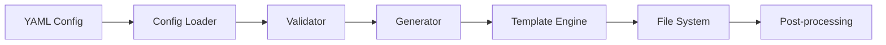
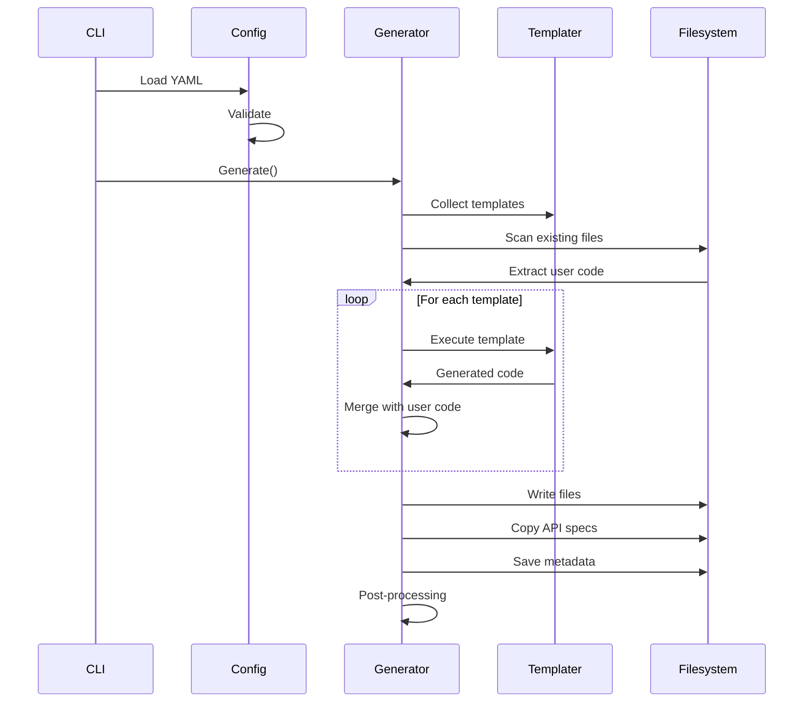

# Архитектура генератора

Go Project Starter — это генератор кода, который читает YAML-конфигурацию и создаёт полностью готовый к запуску Go-проект.

## Обзор



## Ключевые компоненты

### Структура пакетов

```
internal/pkg/
├── config/       # Загрузка и валидация конфигурации
├── generator/    # Оркестрация генерации
├── templater/    # Движок шаблонов
├── meta/         # Метаданные и версионирование
├── migrate/      # Миграции между версиями
├── ds/           # Domain structures
├── init/         # Интерактивная инициализация
└── setup/        # Setup wizard
```

### config/

Загрузка и валидация YAML-конфигурации через [spf13/viper](https://github.com/spf13/viper).

**Основные функции:**

- Парсинг YAML-файлов конфигурации
- Валидация всех секций (main, git, rest, grpc, workers, applications, и т.д.)
- Создание lookup maps для быстрого доступа к элементам
- Установка значений по умолчанию

**Правила валидации:**

1. REST/gRPC сервисы должны быть назначены в applications
2. Драйверы, на которые есть ссылки, должны существовать
3. Имена транспортов, воркеров и драйверов не должны дублироваться
4. ActiveRecord требует указания ArgenVersion
5. Порты обязательны для REST (кроме шаблона `sys`)

### generator/

Оркестрация процесса генерации — центральный компонент.

**Основные этапы:**

1. Сбор шаблонов по категориям (main, transport, worker, logger, app)
2. Сканирование существующих файлов и извлечение пользовательского кода
3. Выполнение шаблонов с параметрами из конфигурации
4. Создание директорий и запись файлов
5. Копирование API-спецификаций (OpenAPI, Protobuf)
6. Сохранение метаданных генерации
7. Выполнение post-generation задач (git init, goimports, go mod tidy)

### templater/

Движок шаблонов с поддержкой сохранения пользовательского кода.

**Особенности:**

- Использование стандартного Go `text/template`
- Embedded filesystem для хранения 78+ шаблонов
- Disclaimer-маркеры для разделения сгенерированного и пользовательского кода
- Кэширование скомпилированных шаблонов

**Структура шаблонов:**

```
templater/embedded/templates/
├── main/              # Makefile, Dockerfile, docker-compose, configs
├── transport/
│   ├── rest/
│   │   ├── ogen/      # OpenAPI 3.0 кодогенерация
│   │   └── template/
│   │       └── sys/   # Health checks, метрики, pprof
│   ├── grpc/          # gRPC сервисы
│   └── kafka/         # Kafka consumers
├── worker/
│   └── template/
│       ├── telegram/  # Telegram бот
│       └── daemon/    # Background daemon
├── app/               # Application layer
└── logger/            # Logger implementations (zerolog, logrus)
```

### meta/

Управление версиями генератора и метаданными проекта.

**Функции:**

- Хранение версии схемы проекта в `meta.yaml`
- Манифест последнего прогона: путь, `kind` (`generated`/`copied`) и хеш каждого
  записанного файла — основа точной orphan-детекции и детекции ручных правок
- Поддержка миграций при обновлении генератора

### migrate/

Автоматические миграции при обновлении генератора.

**Возможности:**

- Переименование файлов при изменении структуры
- Обновление устаревших конфигураций
- Удаление deprecated кода по расписанию

## Процесс генерации



### 1. Загрузка конфигурации

CLI читает YAML-файл и передаёт его в config loader. Поддерживается как один файл (`--config`), так и директория с несколькими файлами (`--configDir`).

### 2. Валидация

Config loader проверяет:

- Обязательные поля (main.name, git.repo)
- Корректность ссылок (транспорты в applications, драйверы)
- Отсутствие дубликатов имён
- Совместимость настроек

### 3. Сбор шаблонов

Generator собирает все необходимые шаблоны на основе конфигурации:

- **main/** — всегда включаются
- **transport/rest/** — если есть секция `rest`
- **transport/grpc/** — если есть секция `grpc`
- **transport/kafka/** — если есть секция `kafka`
- **worker/** — если есть секция `workers`
- **logger/** — на основе `main.logger`

### 4. Извлечение пользовательского кода

Если проект уже существует, generator сканирует файлы и извлекает код, написанный пользователем (код ниже disclaimer-маркеров).

### 5. Выполнение шаблонов

Каждый шаблон выполняется с контекстом, содержащим:

- Данные из конфигурации
- Вспомогательные функции
- Ссылки на связанные сущности

### 6. Слияние кода

Сгенерированный код объединяется с сохранённым пользовательским кодом через disclaimer-маркеры.

### 7. Запись файлов

Результат записывается в целевую директорию.

### 8. Post-processing

После генерации выполняются:

- `git init` (если нет репозитория)
- `goimports` (форматирование импортов)
- `go mod tidy` (обновление зависимостей)

## Disclaimer-система

Уникальная особенность генератора — сохранение пользовательского кода при регенерации.

### Как это работает

Каждый сгенерированный файл содержит маркер:

```go
// Сгенерированный код
package handler

import "context"

type Handler struct {}

// ==========================================
// GENERATED CODE - DO NOT EDIT ABOVE THIS LINE
// ==========================================

// Пользовательский код ниже — переживёт регенерацию
func (h *Handler) CustomMethod() {
    // Ваша бизнес-логика
}
```

### Правила работы

1. **Выше маркера** — сгенерированный код, перезаписывается при регенерации
2. **Ниже маркера** — пользовательский код, сохраняется
3. **Не редактируйте** код выше маркера — изменения будут потеряны

### Преимущества

- Регенерация проекта без потери бизнес-логики
- Обновление инфраструктуры при изменении API
- Добавление новых endpoints без ручного копирования

## Миграция файлов при обновлении генератора

При обновлении генератора файловая структура сгенерированного проекта может измениться:
файлы переименовываются, перемещаются в другие директории, или полностью удаляются
из набора шаблонов. Генератор поддерживает два механизма миграции.

### Переименование файлов (Meta.Version)

**Механизм:** версионный, через `meta/meta.go` (`curVer = 5`).

При первой генерации в `.project-config/meta.yaml` сохраняется `version: <curVer>`.
При последующих генерациях `GenerateFilenameByTmpl()` (в `templater.go`) сравнивает
`lastVer` (из meta.yaml) с текущей и вычисляет старое имя файла:

- `lastVer < 2`: файлы без префикса `psg_` → переименование в `psg_*_gen.go`
- `lastVer < 3`: `pkg/ds/` → `pkg/app/ds/`

Старое имя записывается в `file.OldDestName`, новое — в `file.DestName`.
Генератор находит файл по `OldDestName`, извлекает user code, и записывает
по `DestName`. Пара `(OldDestName → DestName)` попадает в `FilesDiff.RenameFiles`.

**Почему версионный механизм:** переименование невозможно детектировать автоматически.
Файл `handler.go` на диске не содержит информации о том, что он должен стать
`psg_handler_gen.go` — эту связь знает только код миграции. Аналогично, `pkg/ds/types.go`
не знает, что его новый путь — `pkg/app/ds/types.go`. Нужна явная таблица
"старый путь → новый путь", привязанная к версии.

### Удаление устаревших файлов (манифест прогона)

**Механизм:** автоматический, через манифест последнего прогона в `meta.yaml`.

Когда шаблон удаляется из набора (например, при переносе кода в runtime),
сгенерированные файлы остаются на диске. `GetUserCodeFromFiles()` (в `templater.go`)
находит их как **предыдущий манифест минус текущий набор `NewFiles`**:

1. Файл есть в манифесте прошлого прогона — значит, его записал генератор
2. Файл **не входит** в набор `NewFiles` — значит, не будет перегенерирован
3. Хеш на диске совпадает с хешем в манифесте и ниже disclaimer нет user code —
   безопасно удалить

Такие файлы попадают в `FilesDiff.ObsoleteFiles` и удаляются после записи новых
файлов. Если файл содержит user code — генерация завершается ошибкой, чтобы
пользователь мог сохранить свой код. Если сгенерированная часть была изменена
руками (хеш не совпал) — файл **остаётся** на диске и попадает в
`FilesDiff.DriftFiles`: удалять чужие правки молча нельзя. Файлы с
`kind: copied` (спеки, схемы) не удаляются автоматически — их содержимое не наше,
и на них могут быть ручные ссылки.

**Почему манифест, а не поиск disclaimer в содержимом:** до `version: 5` принадлежность
файла генератору определялась по наличию строки disclaimer в его содержимом. Это давало
три режима отказа: посторонний файл со строкой disclaimer (индекс code-intelligence
инструмента, `*_gen.go.orig` от merge-конфликта, бэкап сгенерированного файла) либо
**ронял** прогон с `found user code in stale gen file`, либо **молча удалялся**;
а ручные правки выше маркера нельзя было обнаружить вообще. Манифест отвечает на вопрос
«мы ли записали этот файл» точно, и файлы вне манифеста не читаются вовсе.

Проект без манифеста (`version ≤ 4`) обрабатывается прежним путём — `scanTargetTree()`
обходит всё дерево и ищет disclaimer в содержимом, — и записывает манифест, так что
следующий прогон идёт точным путём. Это тот же идиом миграции, что и у переименований.

### Правка скопированной спеки (`kind: copied`) — ошибка генерации

Для `kind: generated` расхождение хеша — предупреждение: правки выше disclaimer-маркера
перезаписываются, и у автора есть куда перенести код (ниже маркера). У скопированного файла
такого места нет, а источник правки — контрактный репозиторий, поэтому дрейф `copied`
**останавливает прогон**.

Проверка живёт в `Manifest.CheckCopiedDrift()` (`internal/pkg/meta/drift.go`) и вызывается
**первым делом в `Generator.Generate()`**, до записи файлов. Два требования к месту вызова:

1. **До любой записи.** Сгенерированные файлы пишутся на диск раньше, чем `resolveAllSources()`
   → `copyTargets()`; проверка внутри копирующего пасса оставила бы дерево наполовину
   перезаписанным.
2. **До `resolveAllSources()`.** После пре-пасса резолва `Transport.SpecPath` и
   `JSONSchema.Path`/`Schemas[].Path` указывают на временный staging, а в сообщении нужен
   исходный `path` из `project.yaml` — иначе подсказка «правьте в контрактном репозитории»
   бесполезна.

Набор проверяемых файлов собирает `Generator.copiedSpecTargets()`
(`internal/pkg/generator/copy.go`, рядом с копирующим пассом): он повторяет обход
`specCopyTargets`/`schemaCopyTargets` (приложения → транспорты → `SpecPath`; `JSONSchemas` →
`schemaSourcePaths()`) и выводит имя файла в `api/` тем же способом, что и пре-пасс резолва, —
через `SpecSource.TargetFilename()`. Источник для сообщения — `SpecSource.Describe()`
(token-redacted). Нераспарсившийся `path` пре-пасс пропускает: про него корректнее отчитается
резолв, у которого под рукой имя транспорта и индекс записи.

Сравнивается **диск с записанным хешем**, не с источником: контракт мог законно уехать вперёд в
своём репозитории. Записи нет (проект до `version: 5`, новый канал в `project.yaml`) или файла нет
на диске — не дрейф. Орфаны (`copied`-запись, выпавшая из текущего вывода) — ветка `diffOrphans`,
отдельное поведение. `--dry-run` падает так же: он предпросмотр прогона, который не состоится.

Формулировка ошибки (`CopiedDriftError`) и подсказка (`CopiedFileDriftHint`) лежат в `meta`, чтобы
другие каналы, копирующие файлы в проект, переиспользовали их, а не дублировали текст.

Формат записи манифеста и правила хеширования — в [CLAUDE.md](../../CLAUDE.md),
раздел «Regeneration Behavior».

### Сравнение механизмов

| Аспект | Переименование | Удаление |
|--------|---------------|----------|
| Детекция | Невозможна автоматически | Автоматическая (манифест) |
| Механизм | `Meta.Version` + таблица миграций | `Meta.Manifest` минус `NewFiles` |
| Код | `GenerateFilenameByTmpl()` | `GetUserCodeFromFiles()` |
| При добавлении | Добавить case в switch `lastVer` | Ничего — работает автоматически |
| User code | Переносится в новый файл | Блокирует удаление (ошибка) |
| Правка выше маркера | — | Блокирует удаление (`DriftFiles`) |

## Типы генераторов

### REST генераторы

| Тип | Описание | Применение |
|-----|----------|------------|
| `ogen` | OpenAPI 3.0 кодогенерация | Основные бизнес API |
| `template` | Шаблонная генерация | Системные endpoints |
| `ogen_client` | REST клиент | Вызов внешних API |

### Специальные шаблоны

- **`sys`** — системный сервер для Prometheus метрик, health checks, pprof

## Зависимость от Runtime

Генератор зависит от [go-project-starter-runtime](https://github.com/Educentr/go-project-starter-runtime) — библиотеки с runtime-компонентами (middleware, logging, metrics).

При каждом релизе генератора обновляется минимальная версия runtime:

```go
// internal/pkg/templater/templater.go
const MinRuntimeVersion = "vX.Y.Z"
```

## Следующие шаги

- [Архитектура сгенерированного проекта](../architecture/generated-project.md) — структура и паттерны
- [Руководство разработчика](index.md) — workflow и команды
